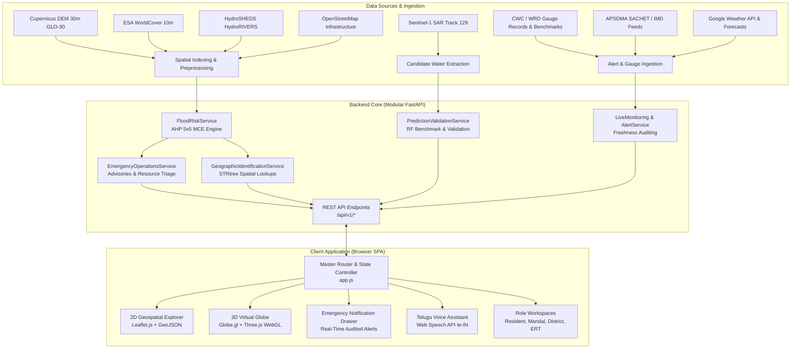

<div align="center">

# PRAVAH 360
### *See the risk. Stay prepared.*
**Geospatial Disaster Intelligence & Emergency Decision Support System**

[](https://fastapi.tiangolo.com)
[](https://www.python.org/)
[](https://leafletjs.com/)
[](https://threejs.org/)
[-brightgreen.svg?style=flat)](tests/)
[](LICENSE)

*Official Academic Major Project:*
**Uncertainty-Calibrated Geospatial AI for Flood Susceptibility and Emergency Resource Allocation**
**Study Region:** Lower Godavari Basin & Delta, Andhra Pradesh, India (21 Mandals)

</div>

---

## 1. Project Overview

Flood management in dynamic alluvial basins requires actionable geospatial intelligence rather than uncalibrated black-box forecasts. The **Lower Godavari Basin** in Andhra Pradesh experiences recurring monsoonal river surges, inundating vulnerable deltaic mandals across Dr. B.R. Ambedkar Konaseema, East Godavari, and West Godavari districts.

**PRAVAH 360** bridges the gap between raw Earth Observation (EO) data and on-the-ground disaster response. Built as an uncertainty-aware geospatial intelligence platform, it turns complex satellite rasters, hydrographic telemetry, and demographic grids into accessible, geographically contextualized decision support for citizens, mandal administrators, and district incident commanders.

### Key Focus Areas:
- **Past (Historical Reconstruction):** Evaluates observed flood footprints from the catastrophic July 2022 Godavari flood (peak stage 17.85 m at Dowleswaram Barrage) using Sentinel-1 C-band Synthetic Aperture Radar (SAR) backscatter analysis.
- **Present (Situational Awareness):** Ingests official warnings (APSDMA SACHET, IMD) alongside authoritative river gauge benchmark records with explicit, transparent **Freshness Badges** to prevent misleading emergency operators with stale telemetry.
- **Future (Susceptibility & Operations):** Computes multi-criteria flood susceptibility (AHP/MCE) across 21 mandals, provides role-based operational coordination, and incorporates the **Resource Allocation Priority Index (RAPI)** knapsack formulation for logistics planning.

---

## 2. Key Capabilities

- **2D Interactive GIS Situation Room:** High-performance Leaflet.js explorer rendering 21-mandal vector boundaries, AHP susceptibility choropleths, river networks, OSM infrastructure lifelines, and georeferenced Sentinel-1 SAR floodwater candidate overlays.
- **3D WebGL Virtual Earth:** Interactive rotating globe powered by Globe.gl (Three.js/WebGL) rendering high-resolution NASA Earth textures, atmospheric effects, and regional viewpoint controls.
- **Mandal-Level Multi-Criteria Evaluation (AHP/MCE):** Mathematical 5×5 pairwise comparison matrix evaluating elevation, slope, distance to river, land cover, and drainage density with verified consistency ($\text{CR} = 0.0001 < 0.10$).
- **Demographic & Infrastructure Exposure:** Quantitative zonal intersection quantifying potential exposure across **9,126,353 baseline residents** and **1,542 critical facilities** (hospitals, educational centres, cyclone shelters, bridges).
- **SAR Observational Candidate Extraction:** Exploratory Sentinel-1 floodwater candidate layer derived from Otsu thresholding ($\tau = -16.4\text{ dB}$) with topographic slope masking ($\theta < 5^\circ$) on Sentinel-1 Track 129 overpass.
- **Emergency Operations & Logistics Management:** Multi-role coordination facilitating citizen distress requests, mandal warning advisories, and district-wide resource requisition (integrating the academic RAPI integer knapsack formulation).
- **Role-Based Operational Personas:** Dedicated tailored workflows for **Residents** (local risk query, shelters, voice guidance), **Mandal Admins** (demographic risk factors, supply requisition), **District Collectors** (basin overview, allocation approvals), and **Response Teams / SDRF** (dispatch matrix).
- **Bilingual Accessibility (Telugu & English):** Native browser **W3C Web Speech API** integration for Telugu (	e-IN) and English voice search, emergency advisories, and auditory warning readouts.
---

## 3. Application Interface & Local Exploration

PRAVAH 360 features a unified, responsive geospatial interface integrating:
- **2D Geospatial Situation Room:** Interactive Leaflet.js explorer with 21-mandal AHP susceptibility choropleths, spatial layer toggles, and inspector drawers.
- **3D WebGL Virtual Earth:** Rotating Earth globe (powered by Globe.gl / Three.js) with NASA Blue Marble textures and regional camera perspectives.
- **Bilingual Telugu Voice Assistant:** Hands-free voice interaction utilizing the browser W3C Web Speech API with native `te-IN` speech synthesis and emergency intent parsing.
- **Audited Emergency Notification Drawer:** Sliding continuous feed displaying verified alerts with transparent source freshness badges (LIVE, CACHED, STALE).
- **Satellite Candidate Water Overlays:** Vectorized exploratory Sentinel-1 C-band SAR surface water candidate footprints over the Lower Godavari delta.
- **Historical & Scenario Timeline Replay:** Synchronized disaster timeline replay with live Dowleswaram Barrage discharge hydrograph surge curves.

To explore the live application interface directly, follow the [**Installation & Setup Guide**](#8-installation--setup-guide) below to launch the local FastAPI server and open [`http://127.0.0.1:8000`](http://127.0.0.1:8000) in your web browser. All authentic UI captures and figures are documented in Chapter 10 of the authoritative academic project report ([`PRAVAH360_Final_Formatted_Report.pdf`](PRAVAH360_Final_Formatted_Report.pdf)).

---

## 4. System Architecture

The PRAVAH 360 platform adopts a decoupled, service-oriented architecture centered on an asynchronous **FastAPI** backend powering a zero-build **HTML5/ES6+ Single Page Application**:



Detailed architectural diagrams (DFD Level 0/1/2, Sequence diagrams, and Component diagrams) are available in [**`docs/architecture/system_architecture.md`**](docs/architecture/system_architecture.md) and [**`report_diagrams/`**](report_diagrams/).

---

## 5. Technology Stack

- **Backend Framework:** [FastAPI](https://fastapi.tiangolo.com/) (Asynchronous ASGI, Lifespan management, Pydantic v2 schemas)
- **ASGI Web Server:** [Uvicorn](https://www.uvicorn.org/) (High-performance async server)
- **Geospatial Processing:** [Shapely](https://shapely.readthedocs.io/) (STRtree R-tree spatial indexing), [GeoPandas](https://geopandas.org/), [Rasterio](https://rasterio.readthedocs.io/), [GDAL](https://gdal.org/)
- **Machine Learning & Validation:** NumPy, SciPy, Scikit-learn (Random Forest classification, Logistic Regression baseline, Brier score calculation)
- **Weather & Location Intelligence:** Google Maps Platform Weather API backend proxy with TTL caching and regional meteorological fallbacks
- **Database & Storage:** SQLite (`data/users.db`), GeoJSON FeatureCollections, Cloud-Optimized GeoTIFFs
- **Frontend Architecture:** Pure ES6+ JavaScript, HTML5, CSS3 (No Webpack/Node build overhead)
- **2D Mapping Engine:** [Leaflet.js](https://leafletjs.com/) v1.9.4 with custom SVG canvas layers and image overlays
- **3D Visualization:** [Globe.gl](https://globe.gl/) & [Three.js](https://threejs.org/) WebGL rendering pipeline
- **Speech & Audio:** W3C Web Speech API (`SpeechRecognition`, `SpeechSynthesis`), Web Audio API

---

## 6. Dataset Inventory & Provenance

| Dataset Name | Source / Provider | Spatial Extent | Resolution | Application Usage | Licensing |
| :--- | :--- | :--- | :--- | :--- | :--- |
| **Copernicus DEM** | ESA / EU Copernicus | Lower Godavari Basin | 30 m (GLO-30) | Elevation, slope, aspect, Topographic Wetness Index | Open Access |
| **ESA WorldCover** | European Space Agency | Tile N15E081 | 10 m | Land cover infiltration resistance factor for AHP | CC-BY 4.0 |
| **HydroRIVERS** | HydroSHEDS / WWF | Asian Region | Vector lines | Stream topology & distance-to-river calculations | Open Research |
| **WorldPop 2020** | Univ. of Southampton | Andhra Pradesh | 1 km UN-adjusted | Zonal population exposure assessment (9,126,353 baseline) | CC-BY 4.0 |
| **OpenStreetMap** | OSM Community | 21 Study Mandals | Vector points/lines | Critical facilities inventory (1,542 lifelines mapped) | ODbL 1.0 |
| **Sentinel-1 SAR** | Copernicus / ESA (GEE) | Track 129 (Konaseema) | 10 m C-band GRD | Observational candidate water surface extraction (July 16, 2022) | Open Access |
| **CWC Stage Benchmarks** | Central Water Commission / AP WRD | Godavari Gauge Stations | Station points | Authoritative gauge records & historical hydrograph replay (Dowleswaram Barrage) | Public Domain |
| **APSDMA SACHET** | Govt. of Andhra Pradesh | Mandal polygons | Near real-time | Official cyclone and flood warning ingestion with freshness auditing | State Govt. |
| **Google Weather API** | Google Maps Platform | Basin Coordinates | Hourly & 10-day | Meteorological forecasts & weather alert proxy with TTL caching | Proprietary / Free Tier |

*Detailed download instructions and reproduction steps are documented in [**`docs/datasets/dataset_inventory.md`**](docs/datasets/dataset_inventory.md).*

---

## 7. Scientific Methodology

1. **Spatial Harmonization:** Planar calculations are performed in **UTM Zone 44N** (`EPSG:32644`); web mapping and vector interchange are preserved in **WGS 84** (`EPSG:4326`).
2. **AHP 5×5 Pairwise Matrix:** Evaluated according to Saaty (1980):
   - Elevation: **0.3125** | Slope: **0.3125** | Distance to River: **0.1875** | Land Cover: **0.0938** | Drainage Density: **0.0938**
   - **Consistency Ratio ($\text{CR}$):** **0.0001** ($< 0.10$).
3. **SAR Water Candidate Classification:** Otsu dual-threshold segmentation on VV backscatter ($\tau = -16.4\text{ dB}$) with slope exclusion ($\theta < 5^\circ$).
4. **Emergency Optimization:** The Resource Allocation Priority Index (RAPI) balances susceptibility, population exposure, mapped infrastructure, and gauge stage:
   $$\text{RAPI}_m = 0.40 \cdot \overline{\text{FSI}}_m + 0.35 \cdot \overline{\text{PopExp}}_m + 0.15 \cdot \overline{\text{Infra}}_m + 0.10 \cdot \overline{\text{CWC}}_m$$
   Discretized using Hare-Niemeyer integer apportionment with Lanka island mandal safety guarantees.

*Comprehensive mathematical proofs are presented in [**`docs/methodology/analysis_methodology.md`**](docs/methodology/analysis_methodology.md).*

---

## 8. Installation & Setup Guide

### Prerequisites
- **Python:** Version 3.10, 3.11, or 3.14 (64-bit).
- **Windows PowerShell** (or Linux/macOS Bash).
- **Git** installed on PATH.

### Installation Steps (Windows PowerShell)

```powershell
# 1. Clone the repository
git clone https://github.com/<your-username>/pravah-360.git
cd pravah-360

# 2. Create and activate a virtual environment
python -m venv .venv
.\.venv\Scripts\Activate.ps1

# 3. Upgrade pip and install dependencies
.\.venv\Scripts\python.exe -m pip install --upgrade pip
.\.venv\Scripts\pip.exe install -r requirements.txt

# 4. Prepare local environment configuration
Copy-Item .env.example .env

# 5. Launch the FastAPI application server
.\.venv\Scripts\python.exe -m uvicorn backend.app.main:app --host 127.0.0.1 --port 8000 --reload
```

### Accessing the System
- **Main Application:** [`http://127.0.0.1:8000`](http://127.0.0.1:8000)
- **Interactive Swagger API Docs:** [`http://127.0.0.1:8000/docs`](http://127.0.0.1:8000/docs)
- **ReDoc Technical Reference:** [`http://127.0.0.1:8000/redoc`](http://127.0.0.1:8000/redoc)

---

## 9. API Overview

The backend exposes structured REST endpoints under `/api/v1/*`:

- `GET /api/v1/geographic/identify-point?lat={lat}&lon={lon}`: Spatial point-in-polygon lookup (<1.2 ms).
- `GET /api/v1/risk/mandals`: Returns GeoJSON of all 21 study mandals with baseline attributes.
- `GET /api/v1/flood-risk/basin-assessment`: Returns basin-wide AHP weights and demographic risk metrics.
- `GET /api/v1/alerts/feed`: Aggregated official emergency alerts with source freshness badges.
- `GET /api/v1/notifications/continuous-feed`: Event stream for sliding emergency notification drawer.
- `GET /api/v1/operations/district/overview`: Multi-mandal operational oversight and summary indicators.
- `POST /api/v1/operations/resources`: Field resource requisition and dispatch status management.
- `POST /api/v1/operations/resident/help-request`: Citizen SOS assistance and distress dispatch.
- `GET /api/v1/prediction/validation-report`: Transparent classification metrics (Accuracy, F1, Brier score).
- `POST /api/v1/voice/tts`: Bilingual Telugu/English speech synthesis endpoint.

*Full parameter specifications are detailed in [**`docs/api/api_reference.md`**](docs/api/api_reference.md).*

---

## 10. Automated Testing

PRAVAH 360 includes **9 automated test suites** covering **109 unit and integration test cases** (100% passing):

```powershell
# Run the complete test suite (with backend server running on port 8000)
.\.venv\Scripts\python.exe -m unittest discover tests/
```

**Verification Results:**
```text
Ran 109 tests in 24.634s
OK
Phase 3 comprehensive validation summary written to: data/metadata/phase3_validation_summary.json
```

---

## 11. Scientific Interpretation & Strict Limitations

To maintain uncompromising scientific honesty, the following boundaries govern all outputs of PRAVAH 360:

1. **Susceptibility vs. Dynamic Inundation:** The AHP map represents static environmental susceptibility (where water naturally gathers based on topography and drainage). It does **NOT** predict the dynamic timing, depth, or velocity of a future flood wave. PRAVAH 360 does not claim 30-metre real-time future inundation forecasting.
2. **AHP Consistency vs. Accuracy:** The AHP Consistency Ratio ($\text{CR} = 0.0001$) verifies mathematical coherence in the pairwise judgment matrix; it is **NOT** a metric of empirical prediction accuracy.
3. **Potential Exposure vs. Affected Population:** The baseline figure of **8,252,724 residents** represents total population residing in High and Very High susceptibility mandals. It reflects **potential exposure**, not verified displaced persons during a specific flood.
4. **Exploratory SAR Water Candidates:** Sentinel-1 radar backscatter reflects open-water specular surfaces. Emergent vegetation, saturated soils, and radar shadow introduce known physical constraints; layers are designated as *exploratory Sentinel-1 floodwater candidate layers*, not verified flood depth maps.
5. **Stored Benchmarks vs. Live Feeds:** CWC and AP WRD gauge levels represent stored authoritative benchmark records and simulated updates for exercise scenarios; they are not live hardware IoT streams.
6. **Experimental ML Benchmarking:** The Random Forest and Logistic Regression models evaluate experimental benchmarking using historical and scenario observations across the 21 mandals with coastal spatial holdouts. These benchmarking results do **NOT** establish independent real-world predictive accuracy for unobserved future flood events.
7. **Simulated Scenario Replay:** The Cyclone Murasu timeline replay is a simulated disaster scenario exercise developed to validate timeline-based decision support, rather than a verified observed meteorological event.

---

## 12. Current Implementation Status

| Feature / Domain | Implementation Status | Operational Details |
| :--- | :---: | :--- |
| **FastAPI Backend Core** | **IMPLEMENTED** | Unified asynchronous service passing 98 automated unit/integration tests. |
| **2D Leaflet GIS Explorer** | **IMPLEMENTED** | 21-mandal vector choropleth, layer toggles, inspector drawer, GeoJSON layers. |
| **3D WebGL Virtual Earth** | **IMPLEMENTED** | Globe.gl (Three.js/WebGL) interactive rotating globe with NASA Blue Marble textures. |
| **AHP 5x5 Susceptibility Engine** | **IMPLEMENTED** | Saaty pairwise matrix ($\\text{CR}=0.0001$), normalized environmental criteria weights. |
| **Sentinel-1 SAR Footprint** | **IMPLEMENTED** | Exploratory Sentinel-1 floodwater candidate layer (`track129_flood_water_candidates.geojson`). |
| **Telugu Voice Assistant** | **IMPLEMENTED** | Web Speech API integration (`te-IN`), query intent parsing, audio synthesis. |
| **APSDMA SACHET Alert Auditing** | **IMPLEMENTED** | Official alert ingestion with transparent multi-state freshness badges (LIVE, CACHED, STALE). |
| **ML Benchmark Validation** | **EXPERIMENTAL BENCHMARK** | Scikit-learn Random Forest & Baseline benchmark using historical and scenario observations; does not establish independent real-world predictive accuracy. |
| **Emergency Operations Store** | **IMPLEMENTED** | Advisories, resource requisitions, and citizen distress help-request workflow. |
| **CWC Hydrological Gauges** | **STORED BENCHMARK / SIMULATED** | Stored benchmark records for 4 stations (Dowleswaram, Bhadrachalam, Polavaram, Kunavaram) with simulated stage update capabilities. |
| **RAPI Knapsack Allocation** | **THEORETICAL FORMULATION** | Academic integer optimization model detailed in report Ch. 4 & 11; planned for future automated solver service. |
| **GloFAS Discharge Assimilation** | *PLANNED* | Upstream hydrological inflow forecasting candidate for future research expansion. |
| **In-situ LoRa IoT Telemetry** | *FUTURE SCOPE* | Physical IoT water level sensor mesh out of scope for current software release. |

---

## 13. Repository Structure

```text
PRAVAH-360/
├── .github/
│   └── workflows/
│       └── ci.yml                          # Continuous Integration test runner
├── backend/
│   └── app/
│       ├── api/
│       │   └── endpoints.py                # REST API router (/api/v1/*)
│       ├── main.py                         # FastAPI application factory
│       ├── schemas/                        # Pydantic v2 data models
│       └── services/                       # Geospatial, risk, alert & ops services
├── data/
│   ├── community/                          # Geotagged citizen hazard reports & photos
│   ├── monitoring/                         # Real-time alert caches & gauge records
│   ├── operations/                         # Emergency store & notification logs
│   ├── processed/                          # Clipped GeoJSONs & resampled rasters
│   └── reference/                          # Historical event catalogs (July 2022)
├── docs/
│   ├── api/                                # REST API specification
│   ├── architecture/                       # System & component architecture
│   ├── archive/                            # Preserved development milestones & logs
│   ├── datasets/                           # Data catalog, provenance & download guides
│   ├── methodology/                        # AHP, SAR, and RAPI mathematical formulations
│   ├── reports/                            # Final test & audit reports
│   ├── screenshots/                        # Genuine application screenshot gallery
│   ├── setup/                              # Local PowerShell installation guide
│   └── repository_audit.md                 # Complete repository audit report
├── frontend/
│   ├── assets/                             # Brand SVGs, icons, raster overlays
│   ├── index.html                          # Single Page Application viewport
│   ├── styles.css                          # Modern responsive styling & dark theme
│   └── app.js                              # Master state, router & GIS controller
├── report_diagrams/                        # 10 High-resolution 300 DPI architecture diagrams
├── scripts/                                # Maintenance, GEE export & pagination scripts
├── tests/                                  # 9 Automated test suites (109 tests)
├── .env.example                            # Safe environment variable template
├── .gitignore                              # Comprehensive GitHub exclusion rules
├── LICENSE                                 # MIT License & 3rd-party data notices
├── PRAVAH360_Final_Formatted_Report.pdf    # Authoritative 86-page Major Project Report
├── PRAVAH360_Final_Formatted_Report.docx   # Editable typeset Word document
├── PRAVAH360_Formatting_QA_Report.md       # Document formatting & QA report
└── README.md                               # This documentation
```

---

## 14. Academic Project Information

- **Institution:** Sri Vasavi Engineering College (Autonomous), Pedatadepalli, Tadepalligudem, AP, India.
- **Department:** Department of Computer Science and Engineering (Artificial Intelligence)
- **Programme:** Bachelor of Technology (B.Tech) in CSE (AI), 2025–2026.
- **Project Title:** *Uncertainty-Calibrated Geospatial AI for Flood Susceptibility and Emergency Resource Allocation*
- **Project Team:**
  - **P. Harini** (Reg. No: `23A81A4348`)
  - **P. Likhitha** (Reg. No: `23A81A4349`)
  - **D. J.S.L.P.Durga** (Reg. No: `23A81A4311`)
  - **K. Mokshagna Sai Teja** (Reg. No: `23A81A4321`)
- **Project Supervisor:** **Mr. M. V. Raghavendra Rao**, M.Tech., (Ph.D.), Assistant Professor, Dept. of CSE (AI).
- **Head of the Department:** **Dr. G. Loshma**, M.Tech., Ph.D.
- **Principal:** **Dr. Ch. Rambabu**, M.Tech., Ph.D.

---

## 15. License & Attribution

- **Source Code:** Released under the [**MIT License**](LICENSE).
- **Third-Party Data:** Satellite imagery and spatial datasets are used under their respective open research terms:
  - Copernicus Sentinel Data & DEM: © European Space Agency (ESA) / Open Access.
  - ESA WorldCover 10m: © ESA WorldCover project / CC-BY 4.0.
  - WorldPop: © WorldPop, University of Southampton / CC-BY 4.0.
  - HydroSHEDS / HydroRIVERS: © World Wildlife Fund, Inc. / Free for research.
  - OpenStreetMap: © OpenStreetMap contributors / ODbL 1.0.
