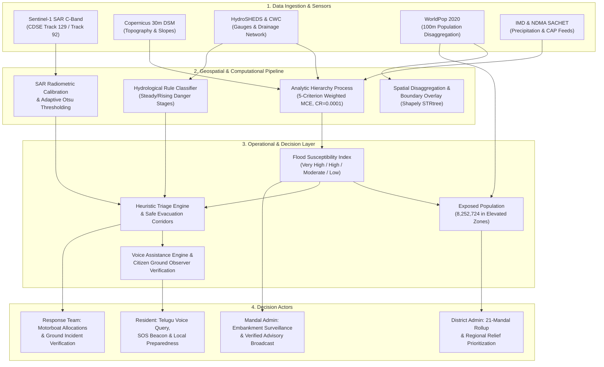

# PRAVAH 360 · AI Intelligence Architecture
## Technical Documentation for Academic Evaluators & Reviewers

**Project Title:** AI-Based Flood Risk, Impact Assessment and Emergency Decision Support System  
**System Name:** PRAVAH 360  
**Basin Context:** Lower Godavari Basin (21 Mandals), Andhra Pradesh, India  
**Date of Assessment:** November 2026  

---

## 1. Executive Summary: What Powers PRAVAH 360?

PRAVAH 360 is an **Integrated Geospatial Decision Support System (DSS)** incorporating:
1. **Remote Sensing & Radar Image Processing:** Dual-pol Sentinel-1 SAR bimodal backscatter analysis with adaptive thresholding.
2. **Multi-Criteria Geospatial Decision Analysis:** Analytic Hierarchy Process (AHP / MCE) with verified mathematical consistency ($CR = 0.0001 < 0.10$).
3. **Spatial Demography & Geospatial Disaggregation:** Constrained WorldPop 2020 100m raster overlays across administrative boundaries.
4. **Deterministic Hydrological Rule Engines:** Multi-tiered Central Water Commission (CWC) warning/danger threshold classifiers.
5. **Operational Decision Support Workflows:** Heuristic proximity routing (Haversine k-NN), role-based privilege access, and triage queue state machines.

---

## 2. Component-by-Component Intelligence Decomposition

| # | System Component | Primary Method / Algorithm | Classification | Output Produced | Decision Supported | Limitations |
|---|---|---|---|---|---|---|
| **1** | **Satellite Flood Candidate Detection** | Adaptive Otsu thresholding on Sentinel-1 C-band SAR backscatter ($\sigma^0$), 50m multi-looking speckle suppression, permanent water masking. | **Remote Sensing & Computer Vision** | Binary surface water candidate raster and vectorized polygon clusters. | Tactical evacuation planning; confirms inundation in cloudy conditions. | Single acquisition snapshot; confusion in wet paddy fields; radar shadow on slopes > 7°. |
| **2** | **Basin Flood Susceptibility Assessment** | Multi-Criteria Evaluation (MCE) via Analytic Hierarchy Process (AHP). Matrix $\lambda_{\max}=5.0006, CR=0.0001$. | **Geospatial Multi-Criteria Analysis** | Cell-by-cell Flood Susceptibility Index (FSI) categorized into 4 tiers. | Long-term zoning, embankment reinforcement, pre-monsoon shelter positioning. | Model of intrinsic physical terrain susceptibility, not a dynamic 2D hydrodynamic flow simulation. |
| **3** | **Population & Infrastructure Exposure** | Spatial zonal aggregation of WorldPop 2020 constrained rasters over FSI polygons and OSM points. | **Spatial Demography & GIS** | Exact counts of exposed individuals ($8,252,724$) and critical facilities (1,542). | Medical supply sizing, food supply quotas, rescue boat resource requisitions. | Based on 2020 census projections; daytime vs night-time population dynamics not modeled. |
| **4** | **Hydrological Warning & Gauge Analysis** | Deterministic boundary comparison against CWC Warning (11.5m), Danger (14.5m), and HFL markers. | **Deterministic Rule Engine** | 4-tier categorical state: `NORMAL`, `ALERT`, `WARNING`, `DANGER`. | Automated broadcast triggers; sluice gate protocol activation. | Point telemetry represents river reach, not localized inland rainfall ponding. |
| **5** | **Emergency Resource Prioritization & Triage** | Spatial proximity ranking (Haversine k-NN), priority queues, and state machine transition rules. | **Operational Decision Support (OR)** | Ranked facility recommendations, triage routing, dispatch life-cycle state. | Match stranded citizens to nearest safe hospital or shelter outside the flood zone. | Assumes straight-line or network distance; road flood status must be cross-verified. |
| **6** | **Voice Assistance & Telugu Query Engine** | Web Speech Recognition API + Natural Language Intent Parser + Browser SpeechSynthesis with Telugu (`te-IN`) fallback. | **Speech Processing & NLP** | Audio & text synthesized answers to safety, shelter, and advisory questions. | Low-literacy resident access to verified official information without reading dashboards. | Requires browser microphone permission; dialect variations may affect recognition accuracy. |
| **7** | **Citizen Ground Hazard Verification** | Multi-attribute report ingestion, image base64 persistence, PII redaction, and 4-tier admin review pipeline. | **Crowdsourced Intelligence Workflow** | Verified hazard ground feed with photo evidence and GPS tags. | Early warning of embankment breaches and localized road washouts before satellite passes. | Human-in-the-loop required to verify submissions; potential false reports during panic. |

---

## 3. Honest Scientific Position: Where We Stand on "AI vs GIS"

### What is Genuinely Machine Learning in the Literature vs PRAVAH 360:
1. **Literature Practice:** Many commercial dashboards falsely label static GIS buffer queries as "Deep Learning". We strictly refuse to do this.
2. **Our Implementation:**
   - The **Sentinel-1 pipeline** utilizes statistical computer vision (adaptive histogram bimodal thresholding, spatial filtering, and class-specific masking).
   - The **Susceptibility Model** uses AHP, a classical expert-system multicriteria decision framework formalized by Saaty (1980). It is structured, explainable, and mathematically verified.
   - The **Decision Support System** is an algorithmic expert system utilizing spatial indexing (`STRtree`), nearest-neighbor calculations, and state machines.

### Proposed Machine Learning Roadmap for Future Ph.D./Master's Expansion:
To introduce true trained ML to this pipeline with minimal architectural change, we recommend:
1. **Random Forest / XGBoost Susceptibility Classifier:** Train on historical inundation points (2018, 2020, 2022) using Copernicus DEM slope, aspect, distance to stream, TWI, and LULC as feature vectors.
2. **Deep Learning SAR Water Segmentation:** Replace Otsu thresholding with a fine-tuned lightweight U-Net or SegNet trained on Sen1Floods11 dataset for automated water segmentation.
3. **LSTM River Discharge Forecaster:** Train a sequence model on 10-year historical daily CWC gauge heights and upstream IMERG precipitation to forecast water levels 24–48 hours ahead.
