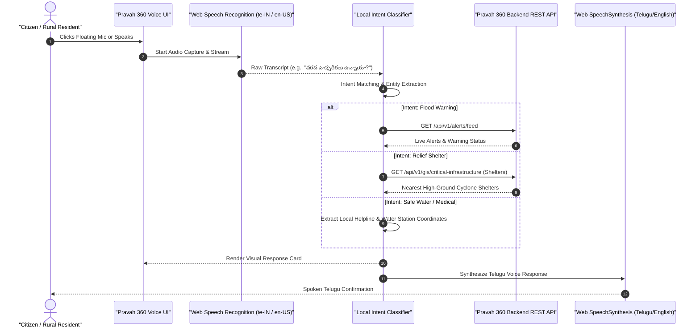

# PRAVAH 360: COMMUNITY ACCESSIBILITY & VOICE INTERACTION ARCHITECTURE

**Document ID:** `DOC-P360-VOICE-HAZARD-2026-V1`  
**Focus Area:** Rural Accessibility, Multimodal Speech Interface, Ground Truth Hazard Reporting, Privacy-Preserving Citizen Crowdsourcing.  
**Audience:** Technical Evaluators, Field Coordinators, Humanitarian Technologists.

---

## 1. Context & Motivation

During extreme flood events in the Godavari delta:
1. **Physical mobility is cut off:** Roads, causeways, and bridges submerge rapidly under backwater surge from the Dowleswaram Barrage.
2. **Connectivity is degraded:** 3G/4G bandwidth drops, power grids fail, and smartphones are operated under rainfall or wet conditions where typing is difficult.
3. **Literacy disparities:** Significant portions of agricultural and fishing laborers cannot easily navigate complex GIS dropdowns, layer trees, or demographic heatmaps.

PRAVAH 360 solves these real-world bottlenecks through two tightly integrated community systems:
- **Vernacular Voice Assistant (`voice_assistant.js`):** Hands-free vocal querying in Telugu (`te-IN`) and English (`en-US`).
- **Ground Hazard & Photo Reporting Portal (`community_hazard_service.py`):** Structured citizen observation intake that feeds verified field intelligence directly to disaster response teams while protecting citizen privacy.

---

## 2. Voice Assistant Architecture

The Voice Assistant utilizes native **W3C Web Speech API** standards, requiring zero external proprietary cloud API keys (e.g. Google Cloud Speech API, ElevenLabs, or Azure Cognitive Services), ensuring offline resilience on modern web browsers (Chrome, Edge, Chromium Android).



### 2.1 Supported Natural Language Intents

The voice intent matcher parses phonetic variations in both colloquial Telugu and English:

| Intent Category | Example Telugu Utterances | Example English Utterances | System Action & Response |
| :--- | :--- | :--- | :--- |
| **Flood Warning / Inundation** | "వరద హెచ్చరికలు ఏమైనా ఉన్నాయా?", "నీటిమట్టం ఎంత?", "ముంపు ఉందా?" | "Are there flood warnings?", "What is water level?", "Is my village safe?" | Queries `/api/v1/alerts/feed`. Synthesizes current CWC barrage warning level (e.g., Warning Level 2, 14.50 ft at Dowleswaram). |
| **Relief Camp & Shelters** | "దగ్గర్లో పునరావాస కేంద్రం ఎక్కడ ఉంది?", "షెల్టర్ ఎక్కడుంది?" | "Where is the nearest relief camp?", "Show evacuation shelter" | Identifies high-ground cyclone relief centers in the mandal and speaks nearest facility location. |
| **Safe Drinking Water** | "మంచి నీరు ఎక్కడ దొరుకుతుంది?", "తాగునీటి ట్యాంకర్ ఎక్కడుంది?" | "Where is safe drinking water?", "Water distribution point" | Directs resident to elevated water treatment plants and tankers; provides water boiling advisory. |
| **Emergency Helplines** | "హెల్ప్‌లైన్ నంబర్ కావాలి", "పోలీస్ లేదా అంబులెన్స్ నంబర్" | "Emergency phone numbers", "Call flood control room" | Highlights 1070 (AP SDMA), 112 (National Emergency), 108 (Ambulance), and 1077 (District Collectorate). |

---

## 3. Citizen Ground Hazard & Photo Crowdsourcing

While satellite synthetic aperture radar (Sentinel-1) provides macro-scale water coverage and AHP provides theoretical susceptibility, **only ground observers can verify micro-scale infrastructural failures** (e.g., a collapsed culvert, breached embankment, or blocked road).

### 3.1 Data Model & Validation Pipeline

Citizen submissions are received via `POST /api/v1/community/hazards/report`:
```python
class HazardReportCreate(BaseModel):
    mandal_name: str           # e.g., "Amalapuram", "Razole"
    hazard_type: str           # "FLOOD_INUNDATION", "ROAD_CUT", "EMBANKMENT_BREACH", "SHELTER_NEEDED", "DRINKING_WATER_CRISIS"
    severity: str              # "CRITICAL", "HIGH", "MODERATE", "LOW"
    landmark: str              # Local colloquial reference (e.g., "Near Clock Tower Panchayat Hall")
    description: str           # Observed depth, flow speed, or trapped citizens
    latitude: Optional[float]  # Geo-coordinates from browser geolocation API
    longitude: Optional[float] # Geo-coordinates from browser geolocation API
    reporter_name: Optional[str] # Citizen name
    contact_phone: Optional[str] # Phone number for rescue coordinator callbacks
    photo_base64: Optional[str]  # Base64 encoded JPEG/PNG captured via camera
```

### 3.2 Automated PII Redaction & Privacy Preservation

To protect citizens from exposure, harassment, or unauthorized tracking:
1. **Public Feed Masking:** When citizen observations are displayed on the public map or public feed (`GET /api/v1/community/hazards`), the backend `CommunityHazardService` automatically redacts identifiable information:
   - `Ramesh Varma` &rarr; `R*** V***`
   - `9848022338` &rarr; `98480*****`
2. **Access-Controlled Unmasking:** Full contact details and unredacted phone numbers are accessible **only to authenticated emergency responders and district administrators** holding verified JWT bearer tokens with `ADMIN` or `OFFICIAL` scopes.

### 3.3 Administrative Review State Machine

Field observations transition through a four-stage verification lifecycle:

```
[SUBMITTED]  --> Citizen submits via mobile/web form. Marked as Unverified.
     |
     v
[UNDER_REVIEW] -> Triage team reviews photo evidence and coordinates with village revenue officer (VRO).
     |
     v
[VERIFIED]   --> Official confirmation that hazard is genuine. Promoted to Response Team GIS layer.
     |
     v
[RESOLVED]   --> Embankment repaired, road cleared, or evacuation completed.
```

---

## 4. Offline & Low-Connectivity Resilience

In rural Godavari conditions:
1. **Form Caching:** If an internet disconnection occurs during report compilation, form inputs are serialized into browser `localStorage`.
2. **Photo Compression:** Uploaded camera images are client-side downscaled to a max resolution of 1280x720 before base64 encoding, reducing payload sizes from >8MB to <250KB to facilitate transmission over congested 2G/3G links.
3. **Optimistic Local Queue:** Once connectivity is restored, cached submissions are automatically dispatched to `/api/v1/community/hazards/report`.

---

## 5. Summary of Implementation Artifacts

- **Backend Service:** [`backend/app/services/community_hazard_service.py`](../backend/app/services/community_hazard_service.py)
- **API Endpoints:** [`backend/app/api/endpoints.py`](../backend/app/api/endpoints.py)
- **Frontend Voice Controller:** [`frontend/voice_assistant.js`](../frontend/voice_assistant.js)
- **Multilingual Lexicon:** [`frontend/translations.js`](../frontend/translations.js)
- **Storage Directory:** `data/community/` (`hazard_reports.json` and `photos/`)
