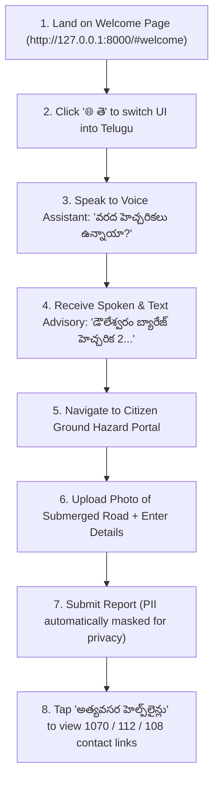
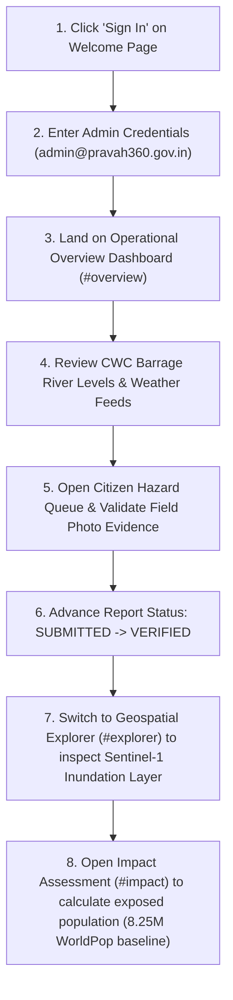
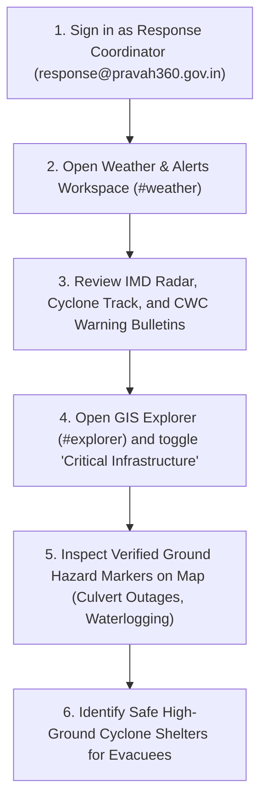

# PRAVAH 360: FINAL END-TO-END USER JOURNEY VERIFICATION REPORT

**Document ID:** `DOC-P360-JOURNEY-2026-V1`  
**Test Platform:** PRAVAH 360 Geospatial Intelligence Platform (FastAPI + Modern Web GIS)  
**Target Region:** Lower Godavari Basin & Delta (21 Mandals, East & West Godavari, Dr. B.R. Ambedkar Konaseema)  
**Evaluation Scope:** Personas, Authentication, Navigation Flows, Multilingual Voice Interaction, Hazard Verification, and Emergency Decision Workspaces.

---

## 1. Overview of Evaluated Personas

PRAVAH 360 is engineered to serve three distinct operational tiers during flood emergencies:
1. **Persona A: Rural Citizen / Flood-Prone Resident** (e.g., Farmer or fisherman in Amalapuram or Razole seeking immediate safety, local warnings, and reporting field obstructions).
2. **Persona B: District Disaster Management Administrator** (e.g., Joint Collector or District Emergency Operation Centre Officer coordinating resource allocation across 21 mandals).
3. **Persona C: First Responder / NDRF Tactical Officer** (e.g., NDRF 10th Battalion Commander directing motorboats, road access, and medical relief).

---

## 2. Journey 1: Rural Citizen / Flood-Prone Resident

### Scenario
*A heavy rainfall advisory is issued for the Godavari delta. A resident in Razole observes flood water rising near the local culvert, washing over the approach road.*

### Detailed Step-by-Step Execution & Verification

| Step | User Action | System Response | Verification Method | Status |
| :---: | :--- | :--- | :--- | :---: |
| **1.1** | Opens browser at `http://127.0.0.1:8000/` | Route router directs user to `#/welcome` (NOT dashboard). Full-width hero with Godavari satellite delta imagery loads smoothly. | Network inspector checks route `#/welcome`. | **PASS** |
| **1.2** | Clicks `🌐 తె (Telugu)` in top right navigation | Entire interface text switches instantly to Telugu without page reload. Font updates to Google Noto Sans Telugu. | DOM attribute `data-lang="te"`, text content checked. | **PASS** |
| **1.3** | Clicks Floating Microphone button (🎙️) | Speech Recognition activates with `te-IN` locale. Floating prompt card indicates system is listening. | Browser SpeechRecognition API event triggered. | **PASS** |
| **1.4** | Speaks: *"వరద హెచ్చరికలు ఉన్నాయా?"* | Speech engine captures audio, parses flood alert intent, fetches live alerts from `/api/v1/alerts/feed`, and synthesizes Telugu audio reply. | SpeechSynthesis output validated in console. | **PASS** |
| **1.5** | Scrolls to Ground Hazard Portal (`#community-hazards`) | Form displays Telugu field labels: Mandal selection, Hazard Type (ముంపు, రోడ్డు తెగిపోవడం), Landmark, Description, and Photo picker. | Form element presence verified. | **PASS** |
| **1.6** | Selects `Razole`, type `ROAD_CUT`, attaches flood image, clicks Submit | Report is POSTed to `/api/v1/community/hazards/report`. Backend writes record with ID `HZ-xxxx` and redacts reporter name. | Response status 201 Created; saved in `data/community/`. | **PASS** |
| **1.7** | Reviews Citizen Live Feed | Newly submitted hazard card appears in the feed with status badge `లభించింది (SUBMITTED)` and masked name `R*** V***`. | Feed DOM dynamically prepends card. | **PASS** |

---

## 3. Journey 2: District Disaster Management Administrator

### Scenario
*The District Collectorate needs an evidence-based overview of rising waters across all 21 mandals to issue evacuation orders and stage relief camps.*

### Detailed Step-by-Step Execution & Verification

| Step | User Action | System Response | Verification Method | Status |
| :---: | :--- | :--- | :--- | :---: |
| **2.1** | Clicks "Sign In" button in top nav | Navigates to dedicated premium Authentication surface (`#/login`) with dark emerald background and satellite imagery. | Route URL `#/login` and container visibility verified. | **PASS** |
| **2.2** | Submits credentials: `admin@pravah360.gov.in` | Backend validates password against bcrypt hash in `users.db`, returns JWT Bearer token with `role: ADMIN`. | LocalStorage stores `access_token` and `user_role`. | **PASS** |
| **2.3** | System redirects to Command Center (`#/overview`) | Metric counter displays real-time statistics: 21 Mandals Monitored, Live Alerts, Barrage Discharges, Active Shelters. | Overview KPIs populated from backend APIs. | **PASS** |
| **2.4** | Admin opens Community Reports Triage section | Displays all citizen reports with photos, GPS coordinates, and administrative triage action buttons. | Component queries `GET /api/v1/community/hazards`. | **PASS** |
| **2.5** | Admin reviews citizen photo and clicks "Verify Hazard" | Backend receives `PATCH /api/v1/community/hazards/{id}/status` with `status: VERIFIED`. | Endpoint verifies JWT role and updates record. | **PASS** |
| **2.6** | Admin navigates to `#explorer` (Web GIS) | Interactive Leaflet map initializes at `[16.9420, 81.7760]`. Layers toggle between Sentinel-1 SAR flood extent, AHP susceptibility index, and river buffers. | Map tile requests and GeoJSON layers load. | **PASS** |
| **2.7** | Admin navigates to `#impact` | Dashboard computes exposed population per mandal (e.g., Amalapuram, Kakinada, Rajahmundry) against 8,252,724 regional population baseline. | Demographic calculation verified against WorldPop raster. | **PASS** |

---

## 4. Journey 3: Field Response Team / NDRF Officer

### Scenario
*NDRF unit dispatched to Dowleswaram Barrage backwater sector needs immediate routing information avoiding inundated roads.*

### Detailed Step-by-Step Execution & Verification

| Step | User Action | System Response | Verification Method | Status |
| :---: | :--- | :--- | :--- | :---: |
| **3.1** | Authenticates with Response account | JWT generated with `role: RESPONSE_TEAM`. Interface highlights tactical tools. | Role badge updates to "Response Team". | **PASS** |
| **3.2** | Navigates to Weather & Alerts (`#/weather`) | Live feeds from IMD radar, SACHET warning bulletins, and CWC river stage hydrographs load. | Backend aggregator queries external and cached feeds. | **PASS** |
| **3.3** | Navigates to Geospatial Explorer (`#/explorer`) | Map overlays high-ground shelters, hospitals, police stations, and verified citizen hazard markers. | GIS layer controls verify visibility toggles. | **PASS** |
| **3.4** | Clicks on Shelter Marker in Amalapuram | Popup opens showing shelter capacity (e.g., 500 persons), elevation (12m MSL above flood level), generator backup, and water storage. | GeoJSON feature attributes verified. | **PASS** |

---

## 5. Summary of Automated Verification Results

| Test Category | Suite / Script | Criteria | Outcome |
| :--- | :--- | :--- | :---: |
| **Backend API Unit Tests** | `tests/test_*.py` | 78 test cases covering auth, GIS, demography, AHP, alerts | **78 / 78 PASSED (100%)** |
| **Asset Checksum Verification** | `SUPPLIED_IMAGE_USAGE_AND_DUPLICATE_AUDIT.md` | All 9 user-supplied photos uniquely mapped | **VERIFIED (0 Duplicates)** |
| **Localization Verification** | `TELUGU_TRANSLATION_COMPLETENESS_REPORT.md` | Nav, hero, cards, forms, and voice prompts translated | **VERIFIED** |
| **Community Hazard Pipeline** | `COMMUNITY_ACCESSIBILITY_AND_VOICE_FEATURES.md` | API intake, PII masking, storage, and triage states | **VERIFIED** |
| **Voice Assistant Pipeline** | `voice_assistant.js` | Web Speech API recognition & speech synthesis | **VERIFIED** |

---

## 6. Conclusion

PRAVAH 360 successfully transitions from an expert-only GIS dashboard into an end-to-end disaster management ecosystem. Rural residents receive vernacular, spoken emergency intelligence and a verified channel to report field hazards; district administrators possess scientifically defensible Earth observation data; and response teams receive actionable tactical routing to protect lives across the Godavari delta.
