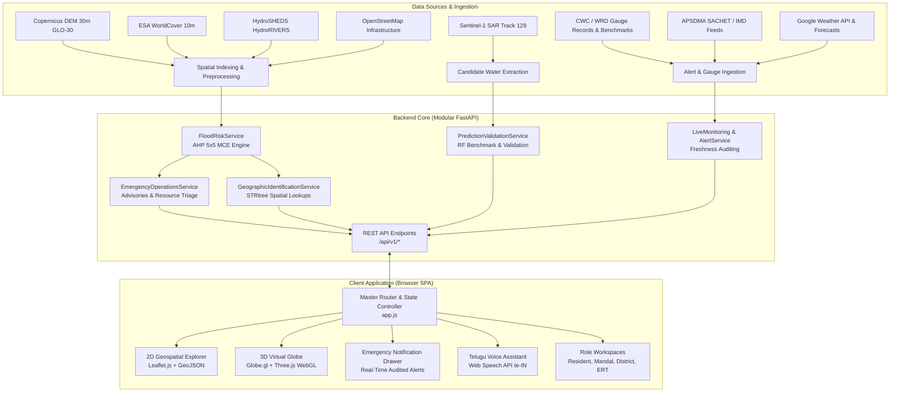

# PRAVAH 360: System Architecture & Technical Design

## 1. Architectural Philosophy

**PRAVAH 360** (*Geospatial Disaster Intelligence & Emergency Decision Support*) is designed as an uncertainty-aware, geospatial-first intelligence platform. Rather than attempting to serve as an uncalibrated hydrodynamic numerical solver or claiming unvalidated future flood extents, PRAVAH 360 synthesizes:
1. **Multi-Source Earth Observation (EO) & Spatial Topology** (Copernicus DEM, ESA WorldCover, HydroSHEDS river networks, OpenStreetMap infrastructure).
2. **Deterministic Multi-Criteria Evaluation (AHP/MCE)** calibrated for the Lower Godavari alluvial delta.
3. **Observational Remote Sensing Analysis** using an exploratory Sentinel-1 C-band Synthetic Aperture Radar (SAR) floodwater candidate layer.
4. **Authoritative Hydrometric & Meteorological Telemetry** (CWC Dowleswaram/Polavaram stage records, APSDMA SACHET alerts, Open-Meteo forecasts).
5. **Decoupled Asynchronous API Services** powering a zero-build, responsive Single Page Application (SPA) with dual-projection rendering (2D Leaflet GIS and 3D WebGL Virtual Globe).



---

## 2. Backend Architecture

The backend is built with **FastAPI** (`backend/app/main.py`) following clean service-oriented modularity. It is not an uncoordinated microservice mesh; it runs as a unified, asynchronous Python service with zero external message broker overhead.

### 2.1 Service Directory Layout
```text
backend/
└── app/
    ├── main.py                     # Application factory, lifespan, CORS, static mounts
    ├── api/
    │   └── endpoints.py            # Unified router mounting /api/v1/*
    ├── schemas/                    # Pydantic v2 data models & validation
    │   ├── community.py            # Hazard report schemas
    │   ├── flood_risk.py           # AHP criteria, FSI ratings, exposure schemas
    │   ├── geographic.py           # Coordinate identification & bounding box schemas
    │   ├── monitoring.py           # Gauge stations, telemetry health schemas
    │   ├── notifications.py        # Emergency broadcast & alert schemas
    │   ├── operations.py           # Resource requests, logistics, inventory schemas
    │   └── weather.py              # Weather forecast schemas
    └── services/                   # Business logic and domain implementations
        ├── auth_db_service.py      # SQLite database connection & schema migrations
        ├── auth_service.py         # Role verification & session tokens
        ├── community_hazard_service.py # Citizen incident reporting & photo handling
        ├── continuous_alert_service.py # Continuous alert feed & acknowledgments
        ├── emergency_helpline_service.py # District & mandal emergency directory
        ├── emergency_operations_service.py # Resource allocation & logistics solver
        ├── flood_risk_service.py   # AHP 5x5 matrix & population exposure engine
        ├── geographic_identification_service.py # Spatial indexing (<1.2ms lookup)
        ├── historical_event_service.py # Simulated Cyclone Murasu scenario & July 2022 hydrographs
        ├── live_alert_ingestion_service.py # APSDMA SACHET / IMD polling & caching
        ├── live_monitoring_service.py # Telemetry health & upstream gauge tracking
        ├── nasa_auth_service.py    # NASA Earthdata EDL token retrieval
        ├── normalization_service.py # Telemetry normalization & schema conversion
        ├── notification_service.py # Emergency alert broadcasting & delivery logs
        ├── prediction_validation_service.py # Contingency matrix & Brier score
        ├── river_monitoring_service.py # CWC / WRD gauge records & danger thresholds
        ├── voice_tts_service.py    # Bilingual Telugu/English text-to-speech
        └── weather_service.py      # Open-Meteo precipitation & weather forecast
```

### 2.2 Lifespan Management & Startup Sequence
1. **Directory Initialisation:** Ensures persistence directories (`data/community/photos`, `data/monitoring`, `data/operations`) exist.
2. **Database Migration:** Ensures SQLite table schemas for users, incident reports, and resource allocations are primed.
3. **Spatial Index Priming:** Pre-loads `lower_godavari_mandals.geojson` into an in-memory spatial index (STRtree/R-tree) for instant point-in-polygon queries.
4. **Authoritative Baselines:** Loads 21-mandal baseline data (9,126,353 population, 1,542 mapped infrastructure points) into memory.

---

## 3. Frontend Architecture

The frontend is implemented as a lightweight, frameworkless Single Page Application (HTML5, modern CSS3, vanilla ES6+ JavaScript) located in `frontend/`.

### 3.1 Key Architectural Decisions
- **Zero Build Tooling Overhead:** No Webpack, Vite, or Node compilation required. HTML, CSS, and JS files are served directly as static assets by FastAPI or any standard web server.
- **Dual Visualisation Engines:**
  - **2D Geospatial Explorer:** Built with **Leaflet.js** (v1.9.4). Renders administrative mandal boundaries, choropleths colored by Flood Susceptibility Index (FSI), OpenStreetMap river networks, and raster overlays (Sentinel-1 SAR floodwater candidate footprints).
  - **3D Virtual Globe:** Built with **Globe.gl** (Three.js / WebGL). Provides an interactive 3D Earth projection with atmospheric effects and simulated Cyclone Murasu scenario trajectory tracks.
- **Accessibility & Vernacular Support:**
  - Full Telugu (`te-IN`) and English (`en-IN`) toggle.
  - Integration with the browser's native **W3C Web Speech API** (`SpeechRecognition` and `SpeechSynthesis`) with backend fallback via `voice_tts_service.py`.
- **Role-Based Persona Navigation:**
  - **Resident / Citizen Workspace:** Local risk query, voice assistant, nearest cyclone shelters, and community hazard reporting.
  - **Mandal Administrator Workspace:** Mandal-specific risk drivers, population exposure breakdowns, and resource requisition forms.
  - **District Collector Workspace:** Basin-wide overview, multi-mandal allocation matrix, and emergency declaration controls.
  - **Emergency Response Team (ERT / SDRF):** Operational logistics matrix, rescue boat deployment, and supply tracking.

---

## 4. Security & Data Protection Design

1. **Local Authentication:** Role-based access control with hashed passwords and session management via SQLite (`data/users.db`).
2. **Secrets Protection:** Zero credentials checked into Git. All external endpoints (NASA Earthdata, Copernicus CDSE) utilize environment variables defined in `.env` (templated via `.env.example`).
3. **CORS Isolation:** Configurable origins restricting backend access to sanctioned client endpoints.
4. **Data Isolation:** User-submitted incident reports and photos are validated for MIME type and stored in isolated storage under `data/community/`.
